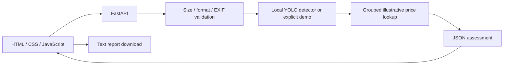

# Architecture

One server serves the UI and API from the same origin. There is no hard-coded API hostname or broad CORS configuration.

Request size is bounded before multipart parsing. The image is decoded with Pillow, constrained by format and pixel count, corrected for EXIF orientation, and converted to RGB. The detector receives a PIL image so RGB channels are not mistaken for OpenCV BGR. CPU work runs outside the asynchronous request loop. A lock protects the shared detector and rejects overlapping inference requests with a retryable response.

The model is loaded only on the first inference and only from the configured local checkpoint. Errors are translated to useful responses without returning internal tracebacks. Demo behaviour is an explicit startup option, included in every response and report.

The frontend checks file type/size before sending, with the backend remaining authoritative. Selection changes invalidate in-flight requests and clear stale results. A ResizeObserver redraws boxes using server-returned oriented image dimensions. Result strings are inserted as text, not HTML. User notes are passed through to the report without altering predictions.

The pricing layer groups detections by class. It uses vehicle-specific sample amounts where supplied, otherwise labelled generic sample amounts, and leaves unknown prices unpriced. No confidence-to-severity or confidence-to-cost conversion is used.
